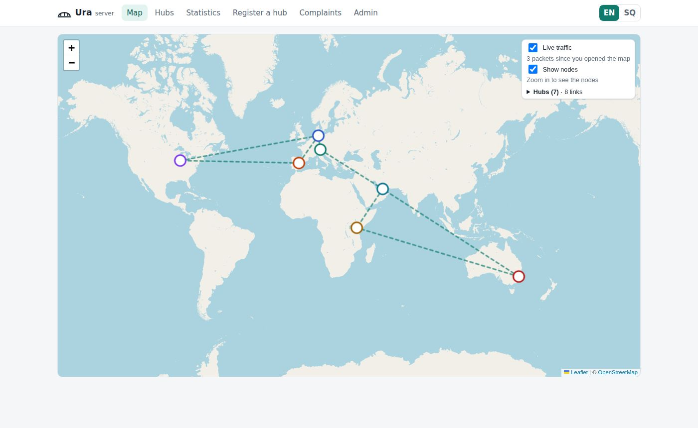
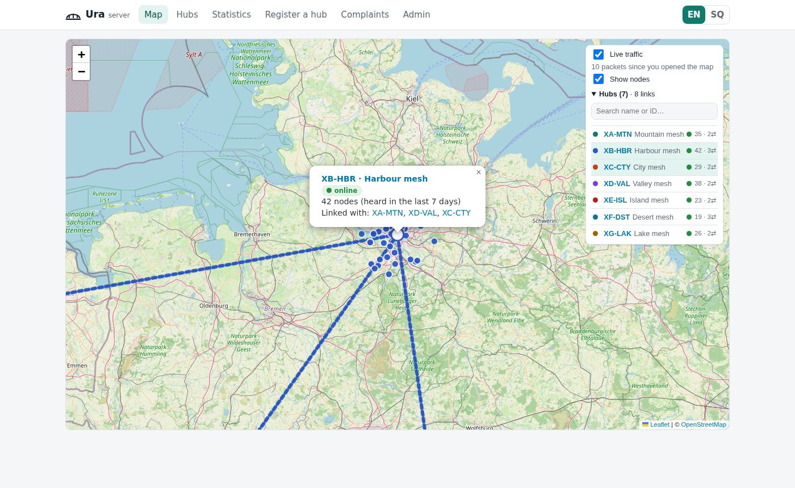
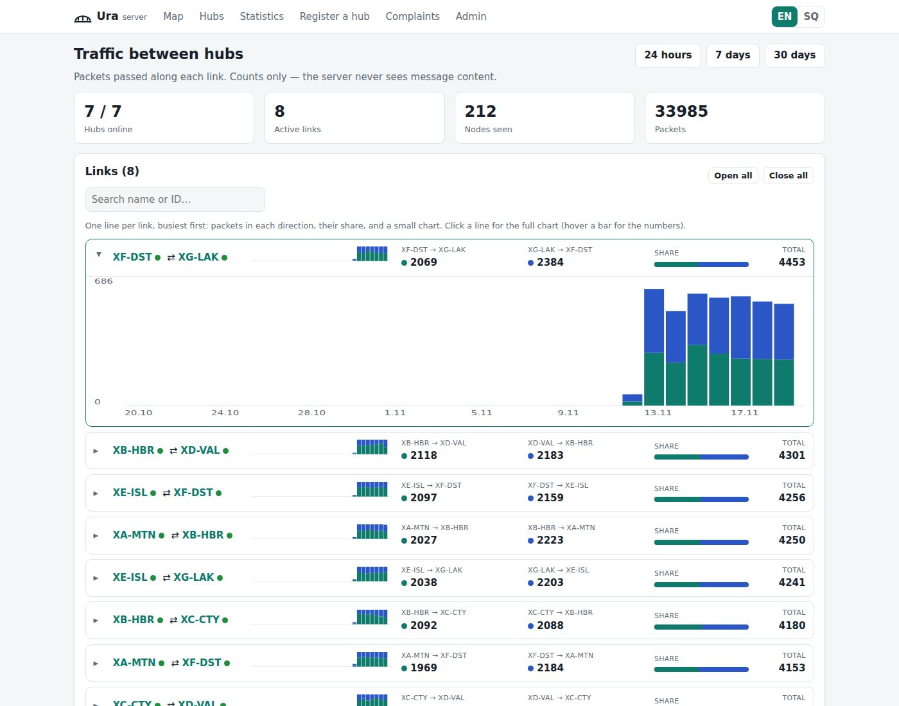
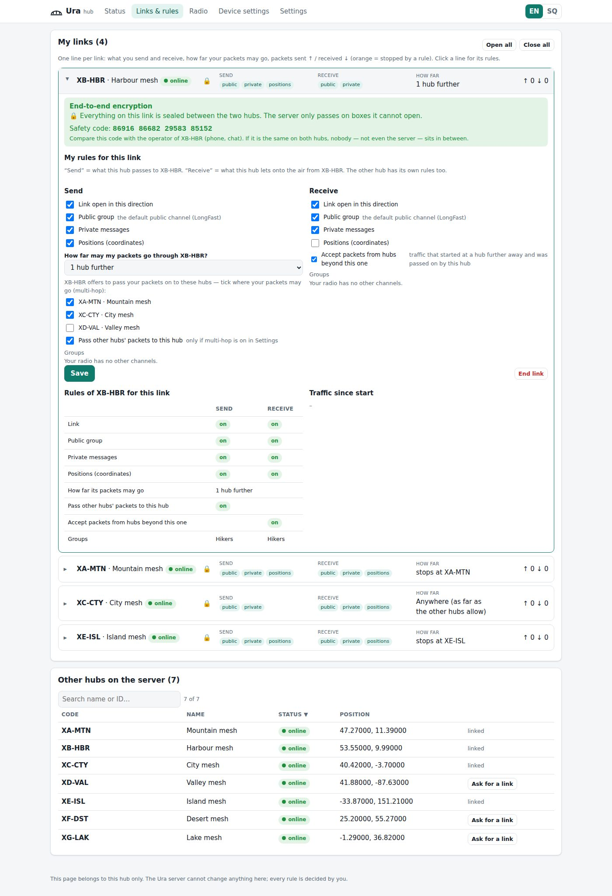
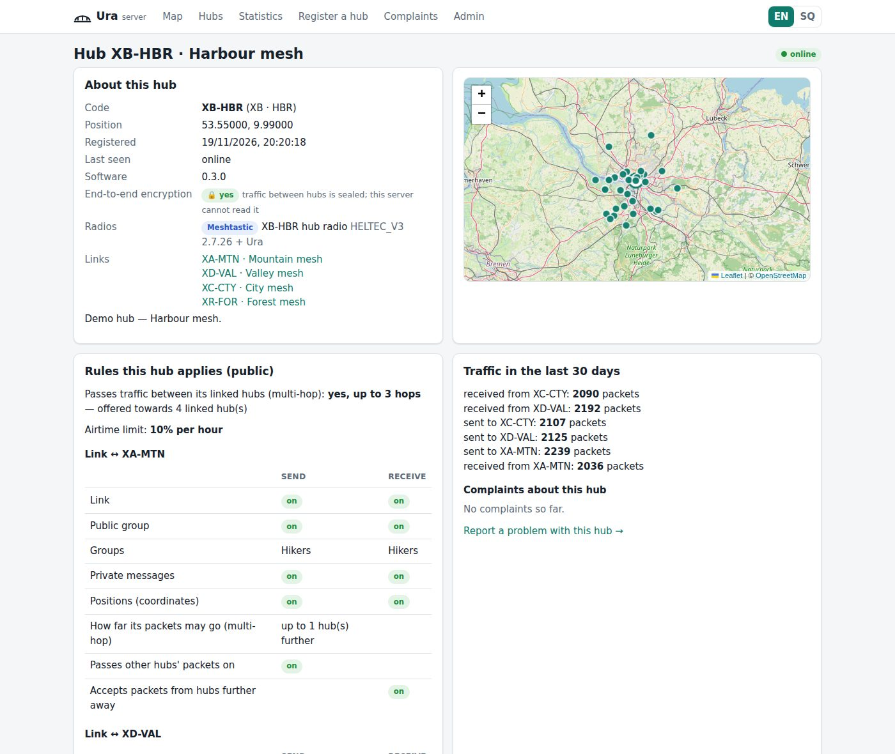
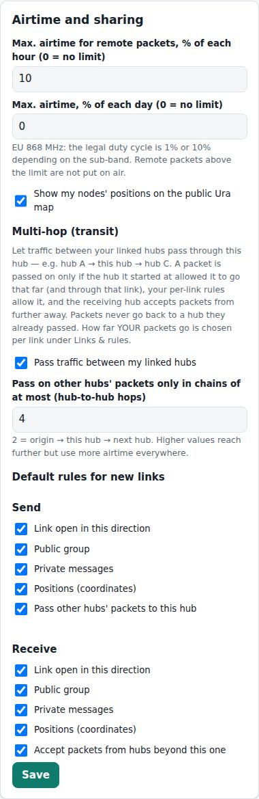
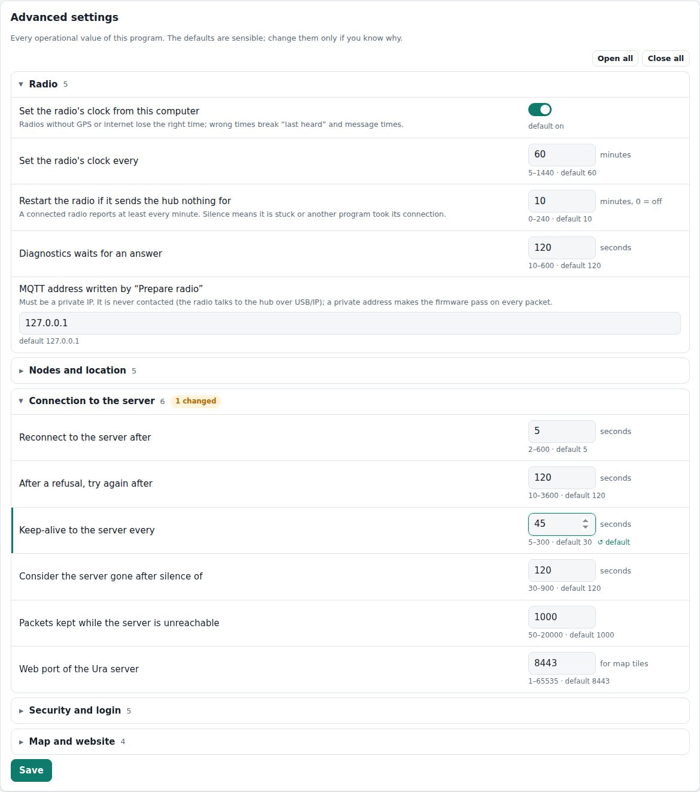

# Ura

*Every mesh, one world.* — *Ura* means **bridge**.

Ura connects separate LoRa mesh networks over the internet, so people anywhere in the world
can reach each other as if they were on the same mesh. A node on the other side of the world
shows up in your Meshtastic app like any local node — in the node list and on the map — and
you message it the normal way: open it, *Send message*. Public channels, private messages,
private groups, positions, telemetry and traceroute all work across the bridge.

**Status:** Meshtastic — working and tested end-to-end with real radios between two countries.
MeshCore — planned next.



**New here? Read [the complete guide](docs/GUIDE.md)** — from installation to the first confirmed
message, what is transmitted, who decides what, multi-hop, and how the encryption keeps the server
blind.

```
   mesh A                                                                       mesh B
 nodes ~~LoRa~~ radio ==USB/IP== ura-hub ==TLS== ura-server ==TLS== ura-hub ==USB/IP== radio ~~LoRa~~ nodes
                (antenna)       (all rules)     (meeting point,     (all rules)       (antenna)
                                                 map, statistics)
                       └───────────── end-to-end encrypted between the hubs ─────────────┘
```

## How it works

- Every participating mesh runs a **ura-hub**: a small Linux computer (Raspberry Pi, mini PC,
  virtual machine) connected to one Meshtastic radio. The hub decides **everything** about its
  traffic — which partners, which channels, which direction, how much airtime.
- One public **ura-server** is the meeting point: hubs register there, find each other, and
  pass end-to-end-encrypted boxes through it. It shows a public map of all hubs and their nodes,
  live traffic and statistics. It **cannot read, store or change** messages, and it cannot
  change any hub's settings.
- Hubs connect *out* to the server — no port forwarding, no public address needed at a site.
- Two hubs exchange traffic only after **both** accepted a link. A hub can also pass traffic on
  between its partners (**multi-hop**), but only to destinations the sending hub allowed.

### Everything is in the hands of the hubs

| | each **hub** | the **server** |
|---|---|---|
| chooses its partners (both sides must accept) | ✅ | ❌ |
| decides what it sends: public channel, each group, private messages, positions | ✅ | ❌ |
| decides what it lets onto its own air from each partner | ✅ | ❌ |
| decides where its packets may travel further (multi-hop) and how far | ✅ | ❌ |
| limits airtime, ends a link at any moment | ✅ | ❌ |
| can read the traffic | its own mesh only | **never** — boxes are sealed end-to-end between the two hubs |
| knows | its own radio and rules | that hub A sent hub B *N* boxes — not what is in them |

The server is only the **meeting point**: it registers hubs (with an administrator's approval),
passes on sealed boxes along links that both hubs accepted, and draws the public map and
statistics. It holds no key that opens the traffic.

### Multi-hop

```
 hub A ──── hub B ──── hub C          B offers: "I can pass your packets to C (and D, E…)"
   │                                  A sets per link: "through B: 1 hub further, only via C" — sealed
   └── A decides, B passes,           C may still refuse packets that did not start at B
       C accepts — all three agree    packets never loop, duplicates are dropped
```

## Features

**Hub website** (`https://<hub>:8091`, owner only)
- **Status** — map of the nodes this hub's own radio hears first, then radio (with watchdog),
  server connection, counters, airtime, and searchable lists of local nodes and of each partner
  hub's nodes.
- **Links & rules** — one compact line per link (any number of links), requests at the top,
  searchable hub list; per link and direction: public channel, private
  groups, private messages, positions, and how far your packets may go through that partner
  (multi-hop, decided per link); end-to-end safety code.
- **Radio** — USB or Wi-Fi/IP connection, one-click *Prepare radio for Ura*, **Diagnostics**
  (private message with delivery check, traceroute, telemetry and position requests, channel test).
- **Device settings** — program the radio from the browser: name, fixed position, channels with
  secure random keys, and every Meshtastic setting.
- **Settings** — hub details and location (from the radio or manual), server registration with
  certificate check, airtime limit, multi-hop, and every operational value as an advanced setting
  (grouped in sections, changed values marked).

**Server website** (`https://<server>`, public + admin)
- World map of hubs, nodes and links with **live traffic**; hub and node pages; statistics per
  link (one bar per hour, split by direction); list of hubs and their codes; transparent complaints process.
- Admin: approve or remove hubs, handle complaints, advanced settings.

**Security** — pinned TLS to the server, per-hub keys (stored hashed), end-to-end encryption
between hubs (X25519, AES-256, HMAC) with safety codes and key-change protection, replay
protection, flood and airtime limits, login lockout, strict web security headers.
Details: [docs/ARCHITECTURE.md](docs/ARCHITECTURE.md#security-model).

### Screenshots

| | |
|---|---|
|  |  |
| *Live map: one hub chosen in the Hubs panel — its nodes and links* | *Statistics: one line per link, click for its chart* |
|  |  |
| *Hub: safety code, send/receive rules, how far packets may go (per link)* | *Server: a hub's public page — links, published rules, traffic, nodes* |
|  |  |
| *Hub: airtime, multi-hop, default rules* | *Hub: advanced settings in sections* |

*Screenshots show a demonstration network with made-up hubs.*

Both websites are available in English and Albanian; more languages are welcome
(see `common/ura.js` and the `Ura.add({...})` blocks in `server/web/app.js` and `hub/web/app.js`).

## Quick start

### Run a hub (to connect your mesh)

You need: a Linux computer that is always on, a Meshtastic radio on USB (recommended) or
Wi-Fi/IP, and the address of a Ura server.

1. **Flash the hub radio** with Meshtastic 2.7 plus the small Ura patch —
   [docs/FIRMWARE.md](docs/FIRMWARE.md). Only the hub radio; all other radios stay as they are.
2. **Install:**
   ```bash
   git clone https://github.com/ximi87/Ura-mesh.git && cd Ura-mesh
   sudo bash contrib/install-hub.sh
   ```
3. **Open** `https://<hub-ip>:8091`, accept the self-signed certificate once and choose a password.
4. **Radio** — choose the USB port (or IP), save, then *Prepare radio for Ura* if anything is
   not green.
5. **Settings** — hub name, your e-mail, country code and place code (2–3 letters each, e.g.
   `XX` + `YY`), location (from the radio or typed in). Enter the server address, press *Check
   server*, compare the fingerprint with the one on the server's *Register a hub* page, trust it,
   and *Send registration request*.
6. After the server admin approves you: **Links & rules** — ask other hubs for a link, set your
   rules per link, compare the safety code with the other operator.
7. **Radio → Diagnostics** — send a private message to a remote node; *delivered* means both
   directions work.

> While the hub runs, **nothing else may be connected to the hub radio** (no app over
> Bluetooth or Wi-Fi). Use a second radio for your phone.

Full guide: [docs/INSTALL-HUB.md](docs/INSTALL-HUB.md)

### Run a server (to create a network of hubs)

You need: a small Linux server with a public address (a domain name is recommended) and two
open TCP ports, 8100 for hubs and one for the website.

```bash
git clone https://github.com/ximi87/Ura-mesh.git && cd Ura-mesh
sudo bash contrib/install-server.sh
```

Open `https://<server>:8443/#/admin`, choose the admin password, and publish the certificate
fingerprint (shown on the *Register a hub* page) so hub operators can check it. With a domain name,
turn on the built-in **Let's Encrypt** certificate in *Admin → Advanced settings* — Ura gets and
renews it by itself, nothing extra to install.

Full guide: [docs/INSTALL-SERVER.md](docs/INSTALL-SERVER.md)

## Configuration at a glance

| Where | What you decide |
|---|---|
| Hub → Links & rules | who you link with; per direction: public channel, groups, private messages, positions; where your packets may travel further (multi-hop); whether you accept traffic from further away |
| Hub → Settings | location, airtime limit (% per hour/day), multi-hop on/off and the longest chain it takes part in, whether your nodes' positions appear on the public map, default rules for new links, advanced values |
| Hub → Device settings | the radio itself: name, position, channels and keys, LoRa region and preset, all modules |
| Server → Admin | which hubs are approved, complaints, whether new registrations are accepted, limits and retention, map tiles, links to the documentation |

Startup options are only the data folder and the ports (`URA_DATA`, `URA_WEB_PORT`, and
`URA_PORT` on the server). Everything else is set on the websites.

## Documentation

| | |
|---|---|
| [docs/GUIDE.md](docs/GUIDE.md) | **start here:** the whole procedure, what is transmitted, who decides, multi-hop, encryption |
| [docs/INSTALL-HUB.md](docs/INSTALL-HUB.md) | install and configure a hub, step by step |
| [docs/INSTALL-SERVER.md](docs/INSTALL-SERVER.md) | install and run a server, domain and certificates |
| [docs/FIRMWARE.md](docs/FIRMWARE.md) | the hub-radio firmware patch: why, build, flash, go back |
| [docs/ARCHITECTURE.md](docs/ARCHITECTURE.md) | how a message travels, rules, multi-hop, what the server knows, security model |
| [docs/PROTOCOL.md](docs/PROTOCOL.md) | hub ↔ server messages, sealed-box format, public API |
| [docs/OPERATIONS.md](docs/OPERATIONS.md) | counters, troubleshooting, airtime, updates, backups, tests |
| [SECURITY.md](SECURITY.md) | reporting security problems |

## FAQ

**Is this like Meshtastic's MQTT?** Ura uses the radio's MQTT *client proxy* to exchange packets
with the hub, but there is no shared public broker: every link is agreed by both sides, traffic is
end-to-end encrypted between hubs, every hub enforces its own rules and airtime limit, and remote
packets go on air as normal LoRa packets (so nodes with *Ignore MQTT* see them too).

**Does every user need special firmware?** No — only the one radio connected to each hub.

**What does the server see?** Who is linked with whom and how many packets pass — never content.
See [docs/ARCHITECTURE.md](docs/ARCHITECTURE.md#what-the-server-knows).

**What about radio regulations?** Each hub operator is responsible for the rules where their
radio transmits (for example duty-cycle limits — the hub has an airtime limit) and for the rules
about relaying traffic over the internet.

## Repository

```
server/   ura_server.py + web/        the server (relay, website, admin)
hub/      ura_hub.py, meshcrypto.py   the hub (radio, rules, end-to-end crypto) + web/
common/   ura.css, ura.js, leaflet/   shared look, translations, map library
firmware/ *.patch                     Meshtastic patch for hub radios
contrib/  install-*.sh, *.service     install scripts and systemd units
tests/                                browser, multi-hop and live tests
docs/                                 documentation
```

## License

MIT — see [LICENSE](LICENSE). Map data © OpenStreetMap contributors; map library Leaflet (BSD-2).
