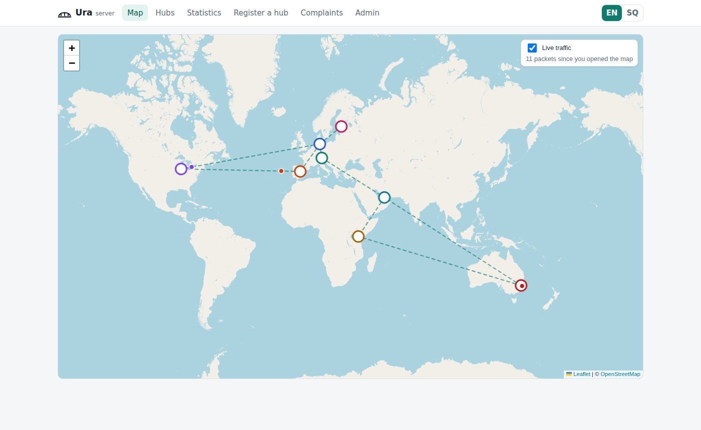
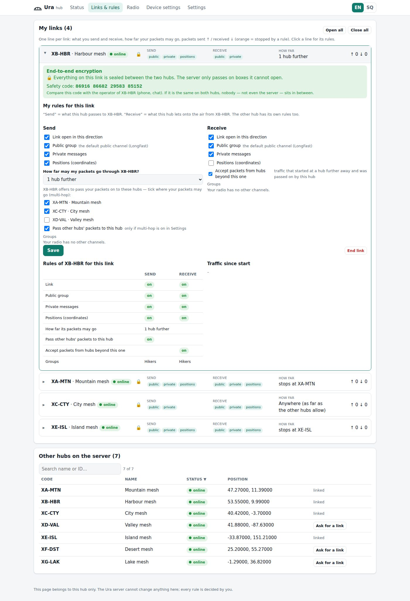
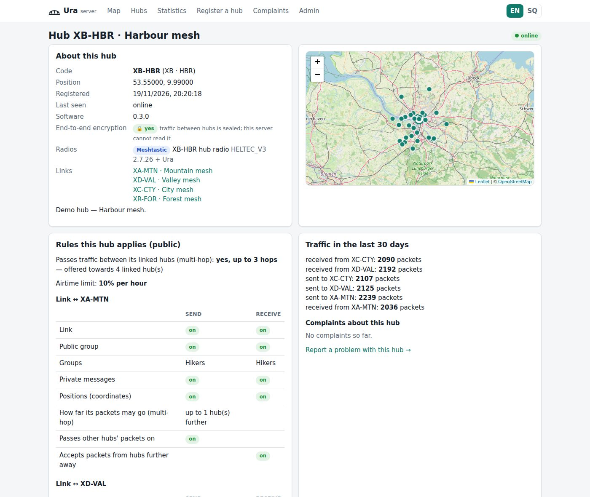
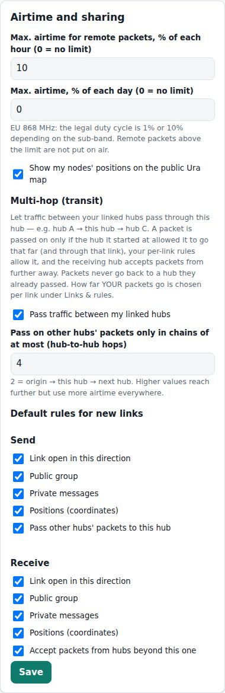
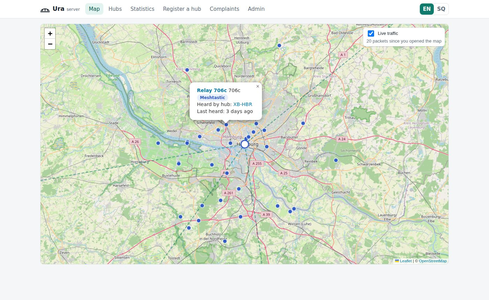
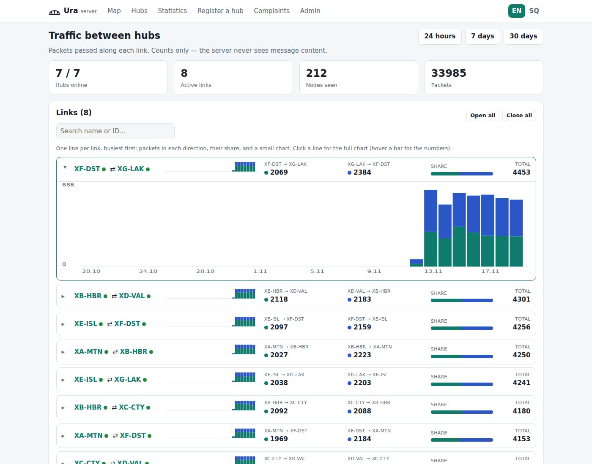
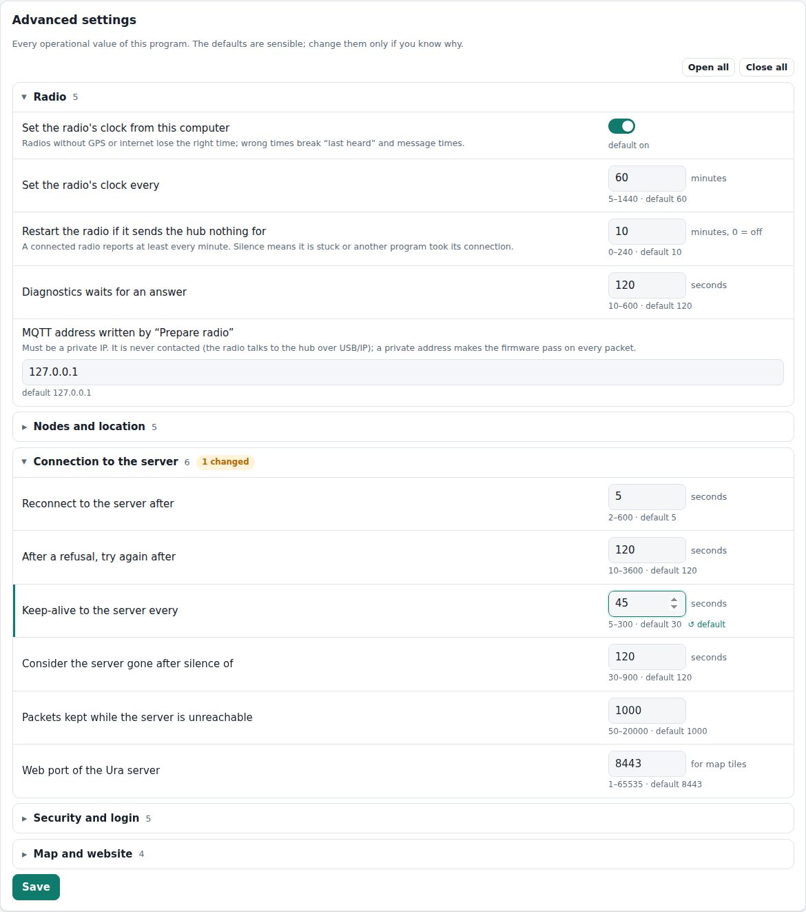

# Ura — the complete guide

This guide explains how Ura works from the first installation to the first confirmed message,
what is transmitted, who decides what, and how the encryption keeps the server blind.
For command-by-command installation see [INSTALL-HUB.md](INSTALL-HUB.md) and
[INSTALL-SERVER.md](INSTALL-SERVER.md).



---

## 1. The idea in one picture

```
          mesh A                                                         mesh B
  ┌─────────────────────┐                                       ┌─────────────────────┐
  │ phones and nodes     │                                       │ phones and nodes     │
  │        ~~ LoRa ~~    │                                       │    ~~ LoRa ~~        │
  │   hub radio (USB)    │                                       │   hub radio (USB)    │
  │       ura-hub A  ════╪═══ TLS ═══►  ura-server  ◄═══ TLS ═══╪═══  ura-hub B        │
  │  ▲ decides EVERYTHING│              meeting point             │ decides EVERYTHING ▲ │
  └──┼──────────────────┘              (blind relay,             └──────────────────┼──┘
     │                                  map, statistics)                            │
     └──────────── sealed boxes: only hub A and hub B can open them ────────────────┘
```

| | **ura-hub** (one per mesh) | **ura-server** (one public meeting point) |
|---|---|---|
| Who runs it | the operator of a local mesh | whoever hosts the network (one per network) |
| Decides | which partners, which channels, which direction, positions or not, multi-hop, airtime | nothing about traffic |
| Sees | the packets of its own mesh (as its radio does) | that hub A sent hub B a box of N bytes — **never what is inside** |
| Can change | its own radio and rules | its own list of approved hubs — not a single hub setting |

The server is a **connection point**, like a post office that forwards sealed envelopes: it
knows that an envelope went from A to B, not what it contains, and it cannot reseal or alter it.

---

## 2. From zero to the first message

### Step 1 — Someone runs a server
A network needs one ura-server with a public address (ideally a domain name). The operator
installs it ([INSTALL-SERVER.md](INSTALL-SERVER.md)), sets the admin password and lets the server
get its free Let's Encrypt certificate for the website. The server shows its **certificate
fingerprint** on the page *Register a hub* — every hub operator will compare it.

### Step 2 — Each mesh prepares a hub radio
One radio per mesh becomes the hub radio. It gets Meshtastic 2.7 with the small Ura patch
([FIRMWARE.md](FIRMWARE.md)) so that packets from other meshes go on air as normal LoRa packets.
Place it where it hears the local mesh well. No other radio needs changes.

### Step 3 — Install the hub
On a Raspberry Pi, mini PC, virtual machine or Proxmox container next to the radio (a container needs the radio passed in — see [INSTALL-HUB.md](INSTALL-HUB.md#running-the-hub-in-a-proxmox-container-ct--lxc)):
```bash
sudo apt update && sudo apt install -y git
git clone https://github.com/ximi87/Ura-mesh.git && cd Ura-mesh && sudo bash contrib/install-hub.sh
```
Open `https://<hub>:8091`, choose a password.

### Step 4 — Connect and prepare the radio (*Meshtastic → Radio*, or *MeshCore → Radio*)
Choose the USB port (or the radio's IP). The page shows the radio's name, firmware and the
checklist **Ready for Ura**. *Prepare radio for Ura* sets everything in one go (MQTT through the
hub, encryption kept, uplink/downlink on every channel, *Ignore MQTT* off). The radio itself
can be fully programmed under **Device settings** — name, position, channels and keys, LoRa
region and preset, every module.

**Channels and keys.** The hub radio can only pass on what it can read: it needs every channel it
should pass on, **with the same name and the same key** as the nodes use. The public channel uses
the default key `AQ==` — leave it so. If your mesh uses its own key, add that channel to the hub
radio (*Meshtastic → Device settings → Channels → Add channels from a Meshtastic link*, or type the key in). A
group crosses between two hubs only when both hub radios have it with the same key and both
operators tick it. Each channel shows its code (equal codes = the radios understand each other);
the *Status* page warns when the radio hears a channel it cannot read, and the hub keeps a copy of
the channels to write back to a new or reset radio. Details: [INSTALL-HUB.md](INSTALL-HUB.md#channels-and-keys--read-this-before-you-continue).

### Step 5 — Describe the hub (*Settings → Hub details*)
Hub name, the operator's e-mail (only the server admin sees it), country code + city / region code
(`XX-YY`, one hub per place), and the location — automatically from the radio or typed in.

### Step 6 — Register and wait for approval (*Links & rules → Link settings → Ura server*)
Enter the server address, press *Check server*, **compare the fingerprint** with the server's
*Register a hub* page, trust it, *Send registration request*. The hub waits for the
administrator. Once approved it appears on the public map with its nodes — **but no traffic
flows yet**. Being registered does not mean anyone can send you anything.

### Step 7 — Ask for a link; the other side accepts (*Links & rules*)
Under *Other hubs on the server*, press *Ask for a link*. The other operator sees *"… asks to
link with you"* and presses **Accept** — or ignores / declines it. A link is active only when
**both** sides accepted. Either side can end it at any time (*End link*); traffic stops at once.

### Step 8 — Compare the safety code
Each active link shows a **safety code** (four groups of five digits). The two operators compare
it once (phone, chat). The same code on both sides proves that the end-to-end keys are the
hubs' own — that nobody, not even the server, sits in between. If a partner's key ever changes,
the link turns red and traffic stops until the operator compares the new code and trusts it.

### Step 9 — Set your rules
For every link, separately for **Send** (what you pass to the partner) and **Receive** (what you
let onto your air from the partner): link open in this direction, public channel, each private
group, private messages, positions, and **how far your packets may go through this partner**
(only to it, 1, 2 … hubs further, or anywhere — chosen per link, see section 4). Details in section 3.

With several links, *Links & rules* shows **one line per link** — partner, online, 🔒 encryption,
what is sent and received, how far your packets may go, packets sent ↑ / received ↓ (an orange
number = packets stopped by a rule). Click a line to open its safety code and rules. Link requests
waiting for you appear at the top; the list of other hubs on the server is searchable.



### Step 10 — Confirm that it works
- **Diagnostics** (*Meshtastic → Radio*): pick any node — local or in the other mesh — and send a
  *private message with delivery check*. **"Delivered — the node confirmed it"** means the
  message reached the node and its acknowledgement came all the way back: both directions work.
  *Traceroute* shows the route (the bridge counts as one hop), *telemetry* and *position* requests
  get the node's answer.
- **Phones:** remote nodes appear in the Meshtastic app's node list and, if they share a position,
  on its map. Tap one, *Send message* — the app shows *delivered* when the remote node confirms.
- **Home map** (click the Ura logo): this hub, its nodes, the linked hubs and their nodes, both
  networks, with a small statistics box. **Meshtastic → Overview** and **MeshCore → Overview** show
  the same map for one network, then radio state, traffic per link (and *why* anything was stopped),
  airtime and node lists. Inside a page the mouse wheel scrolls the page; **Ctrl + wheel** (⌘ on a
  Mac) zooms the map, on a phone **two fingers** move it.
- **Radio watchdog:** a connected radio reports to its hub at least every minute. If it stays
  silent for 10 minutes (adjustable), the hub restarts it and says so on the network's Overview.
- **The server map** shows the link, and dots run along it whenever packets pass.

---

## 3. What is transmitted — and who decides

### What a hub can pass on
Everything the hub radio receives on the channels it has, plus its own packets, travels as the
original Meshtastic packet — still encrypted with the channel key (or, for private messages,
end-to-end between the sending and the receiving radio by Meshtastic itself). The hub reads only its *type*, to apply
the rules:

| packet | examples | governed by |
|---|---|---|
| text on the public channel | chat on the default channel | **Public group** |
| text on a private group | your club's channel | **Groups** (by channel name) |
| private message | one person to another | **Private messages** |
| position, waypoint | map dots | **Positions** |
| node info | name, hardware | the channel it is sent on |
| telemetry | battery, temperature | the channel it is sent on |
| routing / acknowledgements | "delivered" confirmations | the channel it is sent on |
| traceroute, position and telemetry requests | diagnostics | the channel / private messages |

### Every hub decides for itself — in both directions

- **Hub A decides what leaves mesh A** (its *Send* rules) and **what enters mesh A** (its
  *Receive* rules). Hub B decides the same for mesh B. Neither can change the other's rules, and the
  server can change neither.
- A packet crosses only if **the sender's Send rule and the receiver's Receive rule both allow it.**

Examples:

| Situation | Who sets what |
|---|---|
| Mesh A does not want to share positions | Hub A: *Send → Positions* off. Positions never leave mesh A. |
| Mesh B does not want foreign public chatter on its air | Hub B: *Receive → Public group* off. Private messages still arrive. |
| Only a club channel should be shared | Both radios get the channel with the same name and key; both hubs tick that group; *Public group* off on both. |
| One direction only (e.g. a mesh that only listens) | The listening hub: *Send → Link open* off. |
| Too much traffic on the air | *Settings → Airtime limit*: remote packets above the limit are not transmitted. |
| A partner misbehaves | *End link* — immediate. Or contact the server admin / file a public complaint. |

Every hub **publishes its rules** on the server (transparency): anyone can read on the hub's page
what it passes on and accepts.



---

## 4. Multi-hop: passing traffic through a hub

A hub with several links can pass traffic between its partners — for example
hub A → hub B → hub C — but **only where every hub involved agrees**:

1. **Hub B offers.** In *Settings → Multi-hop* B turns transit on and sets the longest chain it takes part in; per link it
   chooses whether it passes other hubs' packets to that partner. B then publishes the list of
   partners it offers.
2. **Hub A chooses for its own packets — separately on every link.** On its link to B, A answers
   *"How far may my packets go through B?"*: *Only to B* (the default), *1, 2 … hubs further*, or
   *Anywhere*. For 1 hub or more it ticks **which of B's links** its packets may continue on.
   A hub with four links can say: link 1 only to that partner, link 2 one hub further (through
   the ticked links), link 3 only to that partner, link 4 anywhere.
3. **The choice travels sealed.** A's distance and its ticked links are sealed
   inside every box — B, C and the server cannot change them.
4. **Hub C can refuse.** *Receive → Accept packets from hubs beyond this one* off = C takes only
   traffic that started at its direct partner.
5. **No loops, no duplicates.** Every box records the hubs it passed; it never returns to one of
   them, and copies arriving over two routes are dropped.



---

## 5. Encryption: three layers, the server holds no key

| layer | protects | keys known to |
|---|---|---|
| **Meshtastic channel / private-message encryption** (unchanged) | the message on the radio and everywhere after it | the radios on that channel; for private messages only the sending and the receiving radio |
| **Ura end-to-end boxes** (X25519 key agreement, AES-256-CTR, HMAC-SHA256) | everything one hub sends another: the packet, its channel, sender, multi-hop list | **only the two hubs of a link** — each hub keeps its private key; the server only relays public keys |
| **TLS to the server** with a pinned certificate | the connection itself, registration, rules | hub and server (the server sees the sealed boxes, never their content) |

What the server **does** know: which hubs exist (name, code, position, the operator's e-mail for
the admin), which links exist, how many boxes and bytes pass per hour, the nodes each hub reports
for the public map. What it **never** knows: message text, channel keys, who wrote to whom, what
kind of packet a box contains.

Even a server operator with full access to the server cannot read traffic, and cannot slip a fake
key in without the operators noticing — the safety codes would no longer match.

---

## 6. The public view

- **Map** — all hubs and their links, with live packet dots running along the links. The nodes
  appear once you zoom in (a world full of nodes is unreadable); *Show nodes* switches them off.
  Click a link line for its packets in the last 7 days. The **Hubs** panel in the corner lists
  one line per hub (searchable); a click flies to that hub, opens its card and highlights its links.
- **Hubs** — a searchable list of every hub with its code, status, nodes and the hubs it is linked
  with. Each hub page shows one line per link — what it sends and accepts, how far its packets may
  go, packets in the last 30 days — and a click opens that link's full published rules.
- **Statistics** — over 24 hours, 7 or 30 days, **one line per link**, busiest first: packets in
  each direction, their share, the total and a small chart. Active links without traffic are listed
  too. A click opens the full chart: one bar per hour (or day), split in two colours for the two
  directions; hovering a bar shows both counts and their share.
- **Complaints** — anyone can report a problem with a hub or node (*New complaint*); every case and
  its answer is public. One line per case, newest first — number, status, date, hub or node, start
  of the text, *answered* — filtered by status and searchable; a click opens the whole case. The
  administrator sees the same list (open cases first) with the answer form inside each case.





---

## 7. Day-to-day

- Updates: `git pull` and restart the service — see the install guides.
- Backups: the hub's `identity.key` and `config.json`; the server's database and certificate.
- Troubleshooting, counters, airtime: [OPERATIONS.md](OPERATIONS.md).
- **Advanced settings** — each where it belongs: radio values under *Meshtastic → Device settings*,
  server and node-announcement values under *Links & rules*, hub values (location following, security
  and login, map and website) under *Settings → Advanced settings*. One compact line per value, changed
  values marked, reset to the default with one click.
- Every page and setting: [CONFIGURE-HUB.md](CONFIGURE-HUB.md).


- **MeshCore** works the same way as Meshtastic: a hub can have one radio of each network, every link
  carries both (switched per link and network), the server relays sealed boxes it cannot open.

*The pictures in this guide show a demonstration network with made-up hubs.*
